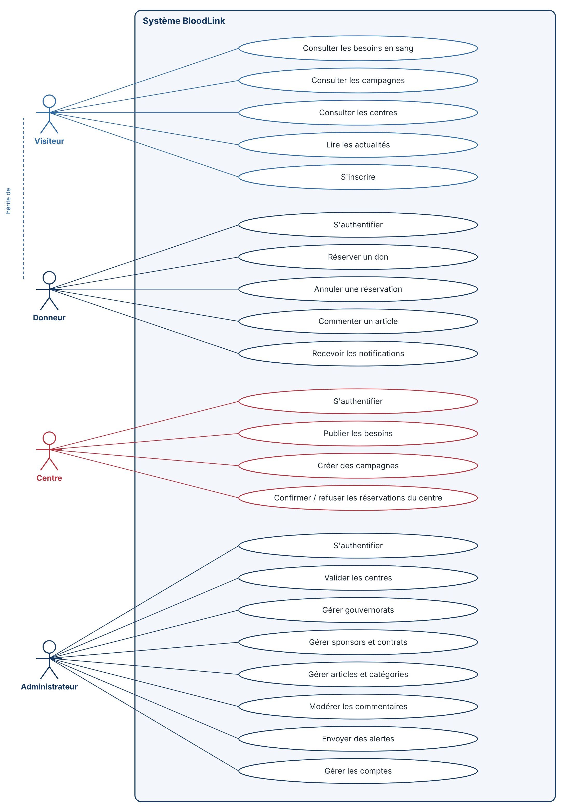

# BloodLink – Blood Donation Platform

> **Relie les donneurs. Sauve des vies.**

## Table des matières

- [Overview](#overview)
- [Features](#features)
- [Tech Stack](#tech-stack)
- [Architecture](#architecture)
- [Contributors](#contributors)
- [Academic Context](#academic-context)
- [Getting Started](#getting-started)
- [Contribution](#contribution)
- [License](#license)
- [Acknowledgments](#acknowledgments)

## Overview

This project was developed as part of the **Web Technologies Project (PW) – 2nd Year Engineering Program** at **Esprit School of Engineering** (Academic Year 2026–2027).

BloodLink est une plateforme web nationale de mise en relation entre **donneurs de sang** et **centres de collecte autorisés** en Tunisie. Elle répond au manque de visibilité des besoins en sang : les centres publient leurs besoins et leurs campagnes, les donneurs consultent, réservent un don et reçoivent des notifications.

## Features

| Espace | Fonctionnalités |
|---|---|
| **Visiteur / Donneur** (Front Office) | besoins en sang filtrables par groupe et gouvernorat, campagnes, centres (lien carte), actualités, commentaires, réservation d'un don, espace personnel (réservations, notifications) |
| **Centre** (Back Office) | publier les besoins, créer des campagnes, gérer les réservations **de son centre** |
| **Administrateur** (Back Office) | valider les centres, gérer gouvernorats, sponsors et contrats, articles et catégories, modération des commentaires, alertes, comptes |

Back Office : tableau de bord (KPI et graphiques), tables avec **recherche, tri et pagination**, CRUD de toutes les entités, rôles et droits (admin / centre).

## Tech Stack

### Frontend
- HTML5, CSS3, JavaScript (sans framework)
- Layouts et partials PHP (Front Office et Back Office)

### Backend
- PHP 8.1+ (architecture MVC)
- MySQL / MariaDB via PDO

## Architecture

Architecture **MVC** suivant le workshop *Template Integration* :

```
bloodlink/
├── public/                     # seule racine web
│   ├── index.php               # contrôleur frontal : session, en-têtes de sécurité, routage (?page=)
│   └── assets/{css,js,img}     # ressources statiques
├── app/
│   ├── routes.php              # page => [contrôleur, méthode, accès]
│   ├── helpers.php             # e(), csrf_field(), navActive(), badge(), flash...
│   ├── config/                 # Database.php, config.example.php, entities.php (pages CRUD)
│   ├── Controllers/            # Controller, CrudController, Auth, Home, Need, Campaign, Centre,
│   │                           # Article, Reservation, Dashboard, Admin*, Error
│   ├── Models/                 # Model (PDO), Centre, Need, Campaign, Article, Reservation, Notification, UserModel
│   └── Views/
│       ├── layout.php          # layout Front : head, spinner, navbar, contenu, footer, scripts
│       ├── layout_admin.php    # layout Back : head, sidebar, header, contenu, footer, scripts
│       ├── partials/           # blocs communs (+ partials/admin/)
│       └── pages/              # contenu propre à chaque page (HTML uniquement)
├── database/bloodlink.sql
├── docs/                       # conception, diagrammes de classes et de cas d'utilisation
└── .github/                    # modèles d'issue et de pull request
```

`Controller::render()` capture le contenu de la page et l'injecte dans le layout, qui assemble les partials avec `require_once` ; le lien actif du menu est calculé avec `$currentPage`. Les pages CRUD du back office sont décrites dans `app/config/entities.php`.

Diagrammes : [conception](docs/conception.md) · 

## Contributors

**Équipe Nexora – classe 2A11**

Mohamed Kassas · Mohamed Ben Zekri · Akrem Jaidane · Aziz Riahi · Aymen Naffeti · Wael Bali

| Module | Responsable |
|---|---|
| 1. Campagnes et sponsors | Mohamed Kassas |
| 2. Centres et gouvernorats | Mohamed Ben Zekri |
| 3. Sponsors et contrats | Akrem Jaidane |
| 4. Articles et commentaires | Aziz Riahi |
| 5. Centres et réservations | Aymen Naffeti |
| 6. Notifications et actualités | Wael Bali |

Tuteurs : Imen El Hakim · Chedy Bouslema

## Academic Context

Developed at **Esprit School of Engineering – Tunisia**
Web Technologies Project (PW) – 2A11 | Academic Year 2026–2027

## Getting Started

### Prérequis
- PHP 8.1 ou plus, MySQL / MariaDB (XAMPP ou WAMP)

### Installation

1. Cloner le dépôt :
   ```bash
   git clone https://github.com/akramjaidane123/bloodlink.git
   cd bloodlink
   ```
2. Démarrer MySQL et importer `database/bloodlink.sql` (phpMyAdmin > Importer). Si une ancienne base `bloodlink` existe, la supprimer d'abord.
3. *(optionnel)* copier `app/config/config.example.php` en `app/config/config.php` et adapter les identifiants (fichier ignoré par Git).
4. Lancer le serveur :
   ```bash
   php -S localhost:8000 -t public
   ```
5. Ouvrir http://localhost:8000/index.php?page=home (avec XAMPP/WAMP : placer le dossier dans `htdocs` / `www` et ouvrir `.../public/index.php`).

### Comptes de démonstration (à changer avant toute mise en ligne)

| Rôle | E-mail | Mot de passe |
|---|---|---|
| Administrateur | `admin@bloodlink.tn` | `Admin@1234` |
| Centre (Tunis) | `centre@bloodlink.tn` | `Centre@1234` |
| Donneur | `donneur@bloodlink.tn` | `Donneur@1234` |

### Sécurité

Détails, tests et réponses aux questions du workshop : [docs/securite.md](docs/securite.md).

Requêtes préparées PDO, mots de passe hachés (`password_hash`), jetons CSRF, sessions sécurisées (expiration 30 min), rôles vérifiés côté serveur (403), échappement des sorties (`e()`), en-têtes HTTP et CSP.

## Contribution

Conventions de branches, commits et pull requests dans [CONTRIBUTING.md](CONTRIBUTING.md). Suivi des tâches : GitHub Projects (To do, In progress, Review, Done).

## License

Distribué sous licence [MIT](LICENSE).

## Acknowledgments

Merci à nos tuteurs Imen El Hakim et Chedy Bouslema, et à l'équipe pédagogique de **Esprit School of Engineering** pour leur accompagnement.
