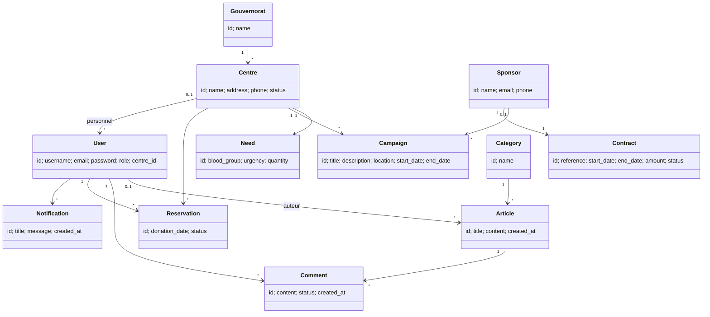
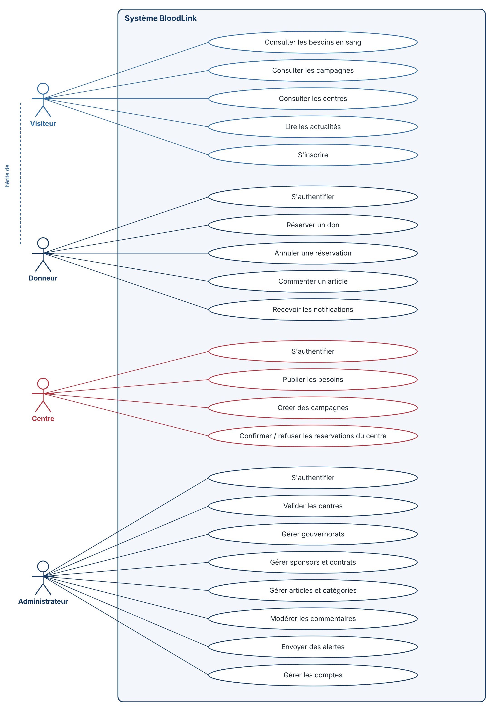

# Conception BloodLink

Diagrammes de la présentation validée (équipe Nexora, 2A11). Les schémas Mermaid s'affichent directement sur GitHub.
Le diagramme de cas d'utilisation corrigé (suite aux remarques des tuteurs) est dans `docs/img/use-case.png` (source vectorielle : `use-case.svg`).

## Répartition des modules

| Module | Jointure (clé étrangère) | Back office | Front office |
|---|---|---|---|
| 1. Campagnes et sponsors | Campagne N — 1 Sponsor | `admin-campaigns` | `campaigns` |
| 2. Centres et gouvernorats | Centre N — 1 Gouvernorat | `admin-centres`, `admin-gouvernorats`, `admin-needs` | `centres`, `needs` |
| 3. Sponsors et contrats | Sponsor 1 — 1 Contrat | `admin-sponsors`, `admin-contracts` | (parrainage affiché sur les campagnes) |
| 4. Articles et commentaires | Article 1 — N Commentaire | `admin-articles`, `admin-comments` | `news`, `article` |
| 5. Centres et réservations | Centre 1 — N Réservation | `admin-reservations` | `reserve`, `dashboard` |
| 6. Notifications et actualités | Article N — 1 Catégorie | `admin-notifications`, `admin-categories` | `dashboard`, `news` |

Tables communes : `users` (donneur, centre, administrateur) et `centres`, référencées par clé étrangère.

## Diagramme de classes

Image : [`img/class-diagram.png`](img/class-diagram.png)

## Diagramme de cas d'utilisation

## Cas d'utilisation couverts

- **Visiteur** : consulter les besoins, les campagnes, les centres, les actualités.
- **Donneur** : s'authentifier, réserver un don, annuler une réservation, commenter un article, recevoir les notifications.
- **Centre** : publier les besoins, créer des campagnes, gérer (confirmer / refuser) les réservations de son centre.
- **Administrateur** : valider les centres, gérer gouvernorats, sponsors et contrats, publier des articles, modérer les commentaires, envoyer des alertes, gérer les catégories.
